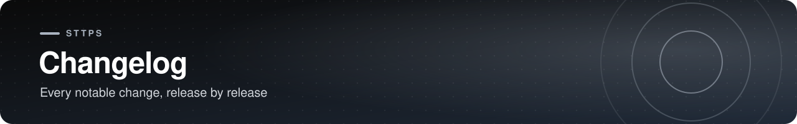

 

<strong>Every notable change to this project, newest first.</strong>

---

> [!NOTE]
> The format follows [Keep a Changelog](https://keepachangelog.com/en/1.1.0/) and the project uses [Semantic Versioning](https://semver.org/spec/v2.0.0.html). Each version links to its full comparison at the bottom of this page, and to its [release notes](https://github.com/saadmaz/STTPS-Website/releases).

## [Unreleased]

### Changed

- Contributing, Security Policy, Code of Conduct, License and Changelog redesigned with branded headers, navigation, tables, diagrams and callouts; the licence is now LICENSE.md.

## [1.1.2] - 2026-11-17

### Changed

- README shows the development environment as awaiting host setup until development deploys are enabled.

## [1.1.1] - 2026-11-17

### Changed

- Redesigned README with a brand banner, live release, CI and deployment badges, action buttons, feature grid, diagrams and collapsible panels.
- Navigation bars and callouts across the contributing, security, conduct and documentation pages.

### Fixed

- Production smoke test no longer fails when Cloudflare's bot protection challenges the CI runner; the challenge confirms the site is up.

## [1.1.0] - 2026-11-17

### Added

- Development and production environments: `develop` deploys to development and `main` to production, through one Deploy workflow and GitHub Environments with per-environment settings.

## [1.0.0] - 2026-11-16

First versioned release of [sttps.co](https://sttps.co).

### Added

- Home page with hero, beliefs, ecosystem and portfolio sections.
- About section with board, industries, what we do and per-topic sub-pages.
- Companies overview, companies in operation, companies in development and a page per brand.
- How we build, capabilities, governance, sustainability, news and careers (with open positions) pages.
- Contact page and privacy and terms pages.
- Per-brand contact methods, falling back to the contact page when none is confirmed.
- Responsive WebP image variants and an image optimisation script.
- Strict Content Security Policy, security headers and immutable caching for hashed assets.
- Continuous integration on every push and pull request: type check, lint, formatting and production build.
- Project governance: proprietary licence, security policy, contribution guidelines, code of conduct, issue forms, pull request template, CODEOWNERS and Dependabot.
- Standard documentation layout shared by every STTPS repository: architecture, configuration, deployment, decision records (ADRs) and release and rollback runbooks, indexed in `docs/README.md`.

### Changed

- Rebuilt on Next.js 16 with a fully static export.
- Hosting moved from cPanel to Cloudflare as an assets-only Worker.
- Typography updated to IBM Plex Sans and Azeret Mono.

[Unreleased]: https://github.com/saadmaz/STTPS-Website/compare/v1.1.2...HEAD
[1.1.2]: https://github.com/saadmaz/STTPS-Website/compare/v1.1.1...v1.1.2
[1.1.1]: https://github.com/saadmaz/STTPS-Website/compare/v1.1.0...v1.1.1
[1.1.0]: https://github.com/saadmaz/STTPS-Website/compare/v1.0.0...v1.1.0
[1.0.0]: https://github.com/saadmaz/STTPS-Website/releases/tag/v1.0.0
