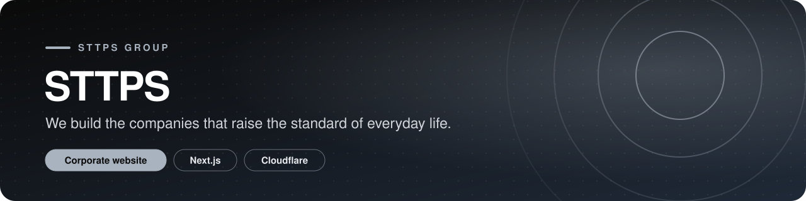
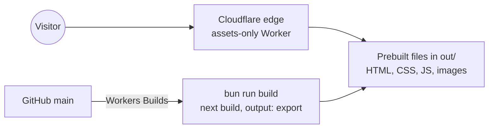
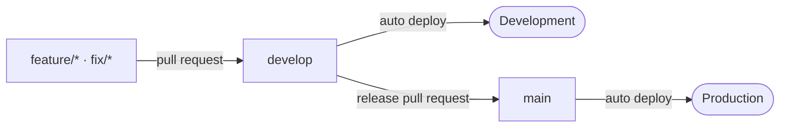

<a id="readme-top"></a>

<div align="center">



<br/><br/>

<p><strong>The corporate website of STTPS, the Sri Lankan group building and operating Tank Sudda, Team Sudda, Polish Station and STOPWASH.</strong></p>

<a href="https://github.com/saadmaz/STTPS-Website/releases"></a>
<a href="https://github.com/saadmaz/STTPS-Website/actions/workflows/ci.yml"></a>
<a href="https://github.com/saadmaz/STTPS-Website/deployments"></a>
<a href="https://github.com/saadmaz/STTPS-Website/commits/develop"></a>


<br/><br/>

<a href="https://sttps.co"></a>
<a href="docs/README.md"></a>
<a href="https://github.com/saadmaz/STTPS-Website/issues/new?template=bug_report.yml"></a>
<a href="https://github.com/saadmaz/STTPS-Website/issues/new?template=feature_request.yml"></a>

<br/><br/>

<a href="#about">About</a> ·
<a href="#features">Features</a> ·
<a href="#architecture">Architecture</a> ·
<a href="#getting-started">Getting started</a> ·
<a href="#deployment">Deployment</a> ·
<a href="#documentation">Documentation</a> ·
<a href="#contributing">Contributing</a>

</div>

---

<details>
<summary><strong>Table of contents</strong></summary>

1. [About](#about)
2. [Features](#features)
3. [Architecture](#architecture)
4. [Tech stack](#tech-stack)
5. [Getting started](#getting-started)
6. [Configuration](#configuration)
7. [Project structure](#project-structure)
8. [Quality checks](#quality-checks)
9. [Deployment](#deployment)
10. [Documentation](#documentation)
11. [Releases and versioning](#releases-and-versioning)
12. [Contributing](#contributing)
13. [Security](#security)
14. [License](#license)

</details>

## About

STTPS builds and operates everyday-care companies across three areas: water and hygiene, property and operations, and vehicle care. This repository powers [sttps.co](https://sttps.co), the group's home for investors, partners, candidates and press.

|                  |                                           |
| ---------------- | ----------------------------------------- |
| **Organisation** | STTPS (Pvt) Ltd                           |
| **Status**       | Live                                      |
| **Website**      | [sttps.co](https://sttps.co)              |
| **Contact**      | [hello@sttps.co](mailto:hello@sttps.co)   |
| **Maintainer**   | [Saad Mazhar](https://github.com/saadmaz) |

<p align="right"><a href="#readme-top">Back to top ↑</a></p>

## Features

<table>
<tr><td width="50%" valign="top"><strong>Group story</strong><br/>About, board, industries, what we do, beliefs, how we build and governance.</td><td width="50%" valign="top"><strong>Portfolio</strong><br/>An ecosystem view of every brand, grouped by category, with companies in operation and in development, and a page per brand.</td></tr>
<tr><td width="50%" valign="top"><strong>Capabilities, careers and sustainability</strong><br/>pages, plus news and legal pages.</td><td width="50%" valign="top"><strong>Fully static</strong><br/>Every route is prebuilt HTML. No server code runs on a request.</td></tr>
<tr><td width="50%" valign="top"><strong>Hardened delivery</strong><br/>A strict Content Security Policy, security headers and immutable caching for hashed assets.</td><td width="50%" valign="top"><strong>Responsive imagery</strong><br/>Source photos are optimised into 640, 1024 and 1400 pixel WebP variants with <code>srcset</code>.</td></tr>
<tr><td width="50%" valign="top"><strong>SEO</strong><br/>Per-page metadata, a generated sitemap and <code>robots.txt</code>.</td><td></td></tr>
</table>

<p align="right"><a href="#readme-top">Back to top ↑</a></p>

## Architecture

A fully static Next.js export served from Cloudflare as an assets-only Worker: every route is prebuilt HTML and no application code runs on a request. Security headers, the Content Security Policy and redirects ship with the assets.



> [!TIP]
> The full design, with every component and data flow, is in [docs/ARCHITECTURE.md](docs/ARCHITECTURE.md). Significant decisions are recorded as [architecture decision records](docs/adr/README.md).

<p align="right"><a href="#readme-top">Back to top ↑</a></p>

## Tech stack

<p>


</p>

<details>
<summary><strong>Full stack breakdown</strong></summary>

| Layer     | Technology                                                                                    |
| --------- | --------------------------------------------------------------------------------------------- |
| Framework | [Next.js](https://nextjs.org) 16 (App Router, static export via `output: "export"`)           |
| Language  | TypeScript (strict)                                                                           |
| Styling   | Tailwind CSS 4                                                                                |
| Motion    | [Motion](https://motion.dev) for animation, [Sonner](https://sonner.emilkowal.ski) for toasts |
| Hosting   | Cloudflare, as an assets-only Worker                                                          |
| Tooling   | Bun, ESLint, Prettier                                                                         |

</details>

<p align="right"><a href="#readme-top">Back to top ↑</a></p>

## Getting started

### Prerequisites

- [Bun](https://bun.sh) 1.4 or later
- Node.js 20.9 or later

### Install and run

```sh
git clone https://github.com/saadmaz/STTPS-Website.git
cd STTPS-Website
bun install
bun run dev
```

The dev server runs at **http://localhost:3000**.

<details>
<summary><strong>All scripts</strong></summary>

| Command                               | Description                                                    |
| ------------------------------------- | -------------------------------------------------------------- |
| `bun run dev`                         | Start the Next.js development server                           |
| `bun run build`                       | Build the static production export into `out/`                 |
| `bun run start`                       | Serve the production build locally                             |
| `bun run typecheck`                   | Generate Next.js types and run `tsc --noEmit`                  |
| `bun run lint`                        | Lint with ESLint                                               |
| `bun run format` / `format:check`     | Format with Prettier, or check without writing                 |
| `bun run scripts/optimize-images.mjs` | Regenerate responsive WebP variants for images in `src/assets` |

</details>

<p align="right"><a href="#readme-top">Back to top ↑</a></p>

## Configuration

The site needs no environment variables or secrets. Build, routing, headers and redirects are controlled by `next.config.ts`, `wrangler.jsonc`, `public/_headers` and `public/_redirects`. All group and brand content lives in `src/data/sttps.ts`.

<details>
<summary><strong>Environment variables</strong></summary>

| File                 | Controls                                                                                                                     |
| -------------------- | ---------------------------------------------------------------------------------------------------------------------------- |
| `next.config.ts`     | Static export, trailing slashes and image handling                                                                           |
| `wrangler.jsonc`     | Cloudflare Worker name, compatibility date, assets directory, `auto-trailing-slash` and `404-page` handling, observability   |
| `public/_headers`    | Content Security Policy, security headers and caching. Keep the CSP in sync with any new script, style, image or font source |
| `public/_redirects`  | Redirects between paths                                                                                                      |
| `src/app/sitemap.ts` | The list of routes published in `sitemap.xml`                                                                                |
| `src/app/robots.ts`  | `robots.txt` rules                                                                                                           |

Where each value is set, and which are secret: [docs/CONFIGURATION.md](docs/CONFIGURATION.md).

</details>

> [!NOTE]
> Copy, business data, imagery and articles are edited as described in [docs/CONTENT.md](docs/CONTENT.md).

<p align="right"><a href="#readme-top">Back to top ↑</a></p>

## Project structure

<details>
<summary><strong>Repository layout</strong></summary>

```
.
├── .github/              # CI workflow, issue and pull request templates
├── public/               # Static files served as-is: favicon, robots.txt, _headers, _redirects
├── scripts/              # Image optimisation
├── src/
│   ├── app/              # Routes (App Router), one folder per page or section
│   ├── assets/           # Source images and their optimised variants
│   ├── components/
│   │   ├── site/         # Layout chrome: navigation, footer
│   │   └── ui/           # Reusable UI primitives
│   ├── data/sttps.ts     # All group and brand content
│   └── lib/              # Shared utilities
├── next.config.ts        # Static export configuration
└── wrangler.jsonc        # Cloudflare assets-only Worker configuration
```

</details>

<p align="right"><a href="#readme-top">Back to top ↑</a></p>

## Quality checks

Every pull request into `develop` or `main` runs the [CI workflow](.github/workflows/ci.yml): type check, lint, formatting and a production build. Pull requests merge only when CI is green.

```sh
bun run lint && bun run format:check && bun run typecheck && bun run build
```

> [!IMPORTANT]
> Run the same checks locally before opening a pull request. They are the exact commands CI runs.

<p align="right"><a href="#readme-top">Back to top ↑</a></p>

## Deployment

| Environment | Branch    | URL                                  | Status                                                                                                                                                          |
| ----------- | --------- | ------------------------------------ | --------------------------------------------------------------------------------------------------------------------------------------------------------------- |
| Development | `develop` | [dev.sttps.co](https://dev.sttps.co) |  |
| Production  | `main`    | [sttps.co](https://sttps.co)         |     |



Cloudflare Workers Builds builds and serves each branch; the Deploy workflow verifies the build and the live URL. Environments, setup, secrets and post-deployment checks are in [docs/DEPLOYMENT.md](docs/DEPLOYMENT.md).

> [!TIP]
> To ship or undo a release, follow the [release](docs/runbooks/release.md) and [rollback](docs/runbooks/rollback.md) runbooks.

<p align="right"><a href="#readme-top">Back to top ↑</a></p>

## Documentation

Every STTPS repository uses the same documentation layout.

| Document                               | Covers                                               |
| -------------------------------------- | ---------------------------------------------------- |
| [Documentation index](docs/README.md)  | Every document in this repository                    |
| [Architecture](docs/ARCHITECTURE.md)   | How the system is built and how data flows           |
| [Configuration](docs/CONFIGURATION.md) | Environment variables and configuration files        |
| [Deployment](docs/DEPLOYMENT.md)       | Environments, hosting, pipeline and first-time setup |
| [Content](docs/CONTENT.md)             | Updating copy, business data, imagery and articles   |
| [Decision records](docs/adr/README.md) | Why the system is built the way it is                |
| [Runbooks](docs/runbooks/README.md)    | Release and rollback procedures                      |

<p align="right"><a href="#readme-top">Back to top ↑</a></p>

## Releases and versioning

[](https://github.com/saadmaz/STTPS-Website/releases)

The project follows [Semantic Versioning](https://semver.org). Every release is tagged `vX.Y.Z`, published on the [Releases](https://github.com/saadmaz/STTPS-Website/releases) page with its notes, and recorded in [CHANGELOG.md](CHANGELOG.md). The procedure is in [docs/runbooks/release.md](docs/runbooks/release.md).

<p align="right"><a href="#readme-top">Back to top ↑</a></p>

## Contributing

| Step |                                                                           |
| ---- | ------------------------------------------------------------------------- |
| 1    | Branch from `develop` using a type prefix (`feat/`, `fix/`, `docs/`, ...) |
| 2    | Commit with [Conventional Commits](https://www.conventionalcommits.org)   |
| 3    | Open a pull request into `develop` and complete the checklist             |
| 4    | Squash and merge once CI is green and the change is reviewed              |

The full guide is in [CONTRIBUTING.md](CONTRIBUTING.md). Everyone taking part follows the [Code of Conduct](CODE_OF_CONDUCT.md).

<p align="right"><a href="#readme-top">Back to top ↑</a></p>

## Security

> [!IMPORTANT]
> Never report a vulnerability in a public issue. Follow [SECURITY.md](SECURITY.md) to report it privately; you will hear back within three business days.

<p align="right"><a href="#readme-top">Back to top ↑</a></p>

## License

Copyright © 2026 STTPS (Pvt) Ltd. All rights reserved.

This is proprietary software. The source is publicly visible, but no permission is granted to use, copy, modify or distribute it without prior written consent. See [LICENSE](LICENSE).

<div align="center">
<br/>
<sub>Built and maintained by the STTPS team · Part of the <a href="https://sttps.co">STTPS group</a></sub>
</div>
