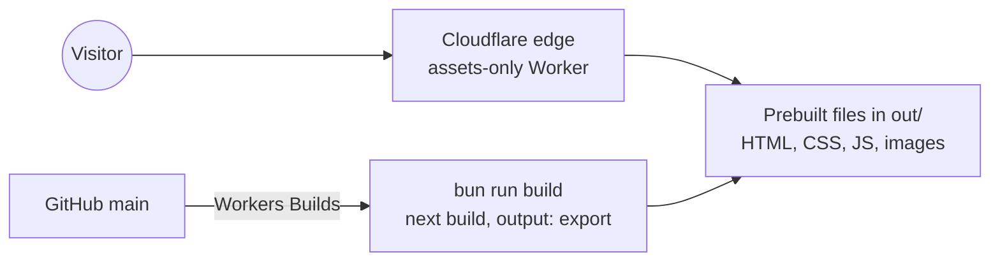

# Architecture

<!-- nav -->

<a href="../README.md">Project README</a> · <a href="README.md">Documentation index</a>

> How sttps.co is built and served. Part of the [project documentation](README.md).

## Overview

sttps.co is a fully static Next.js site. Every route is prebuilt to HTML at build time and served from Cloudflare's edge as an assets-only Worker. No application code runs on a request.

## Building blocks

| Part                   | Responsibility                                                                       |
| ---------------------- | ------------------------------------------------------------------------------------ |
| `src/app/`             | App Router routes, one folder per page or section, each exporting its own `metadata` |
| `src/data/sttps.ts`    | Single typed source for group, brand, board and contact data                         |
| `src/components/site/` | Layout chrome: navigation and footer                                                 |
| `src/components/ui/`   | Reusable UI primitives                                                               |
| `public/_headers`      | Security headers, Content Security Policy and caching rules                          |
| `public/_redirects`    | Path redirects                                                                       |
| `wrangler.jsonc`       | Worker configuration: assets directory, trailing-slash handling and 404 page         |

## Key properties

- **Static by design.** `next.config.ts` sets `output: "export"` and `trailingSlash: true`; each route is a directory index such as `out/about/index.html`.
- **Strict security headers.** A Content Security Policy, `X-Frame-Options: DENY`, `nosniff`, a strict referrer policy and a locked-down permissions policy apply to every response.
- **Immutable caching** for content-hashed files under `_next/static`; HTML is not cached so a deploy is visible immediately.
- **Responsive images.** Source photos in `src/assets/` are converted into 640, 1024 and 1400 pixel WebP variants by `scripts/optimize-images.mjs` and served with `srcset`.

Significant decisions are recorded in [adr/](adr/README.md).
